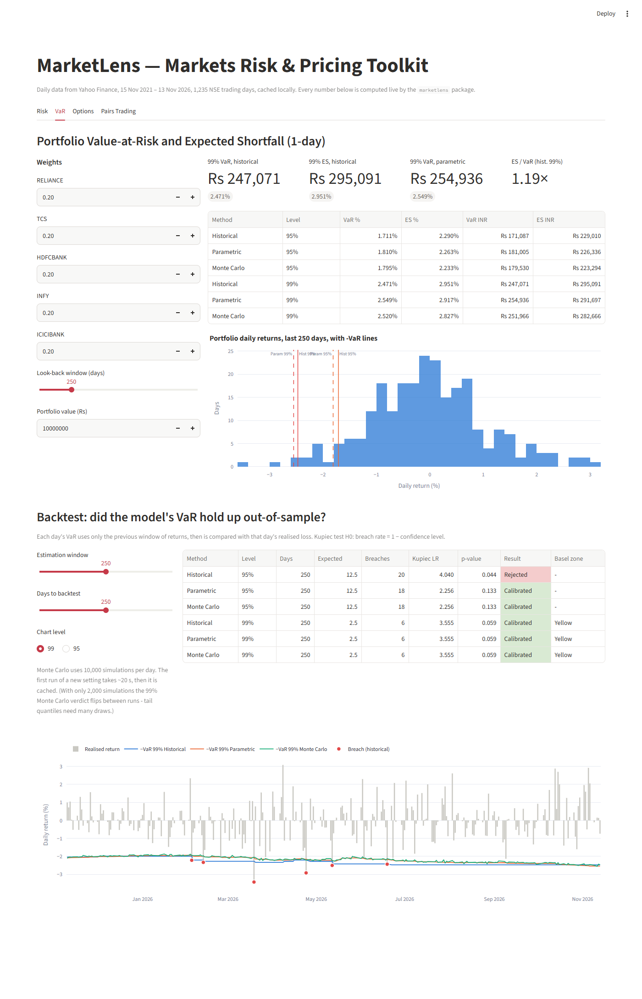
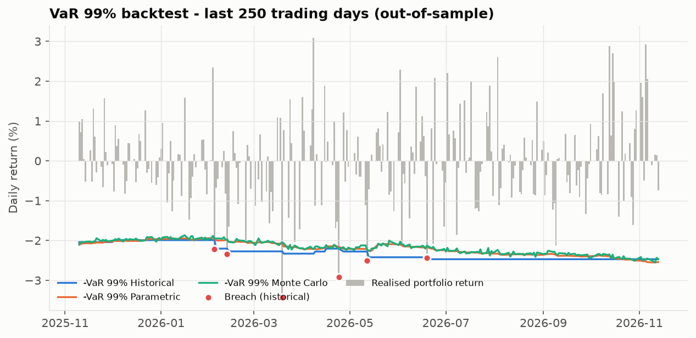
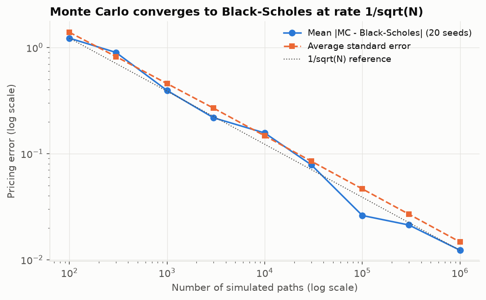
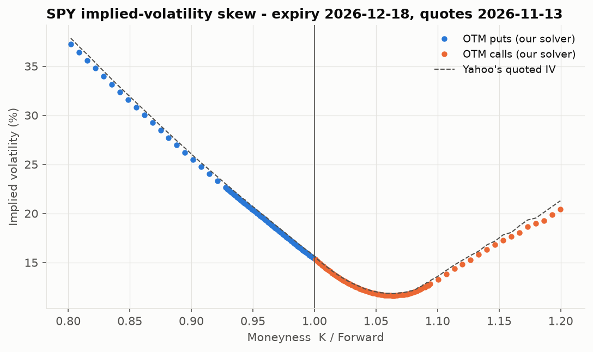
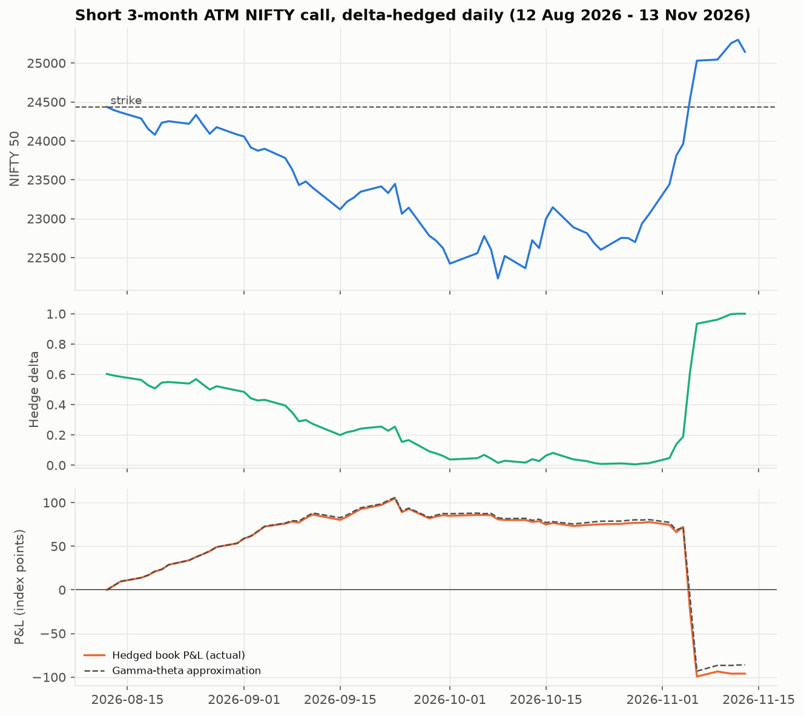
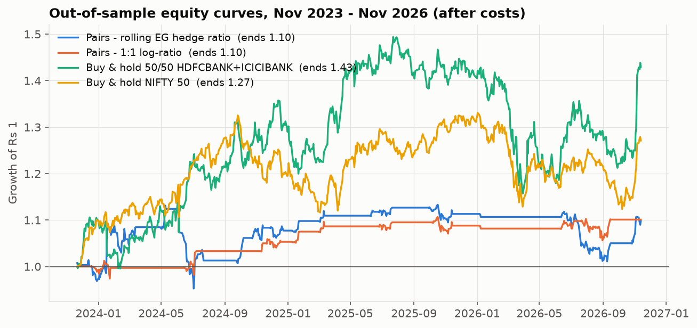
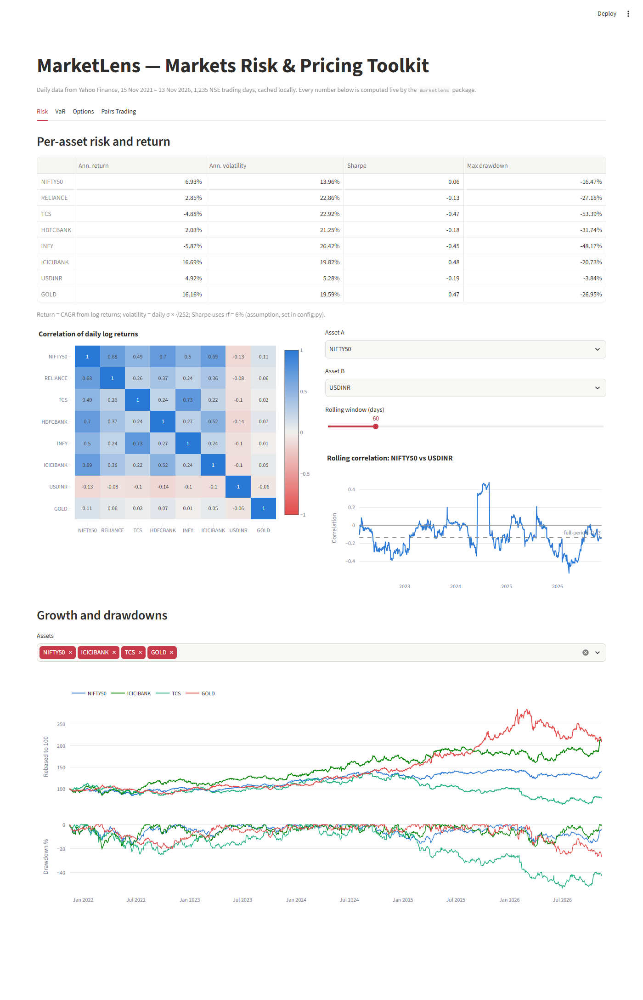
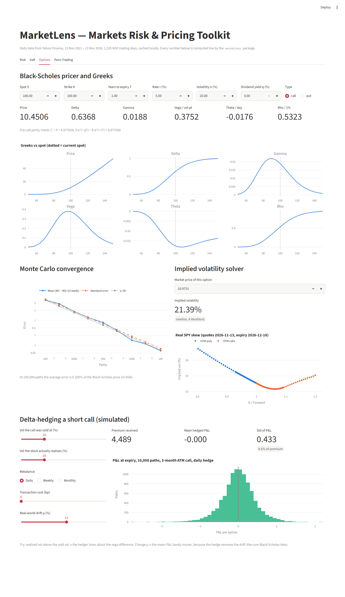
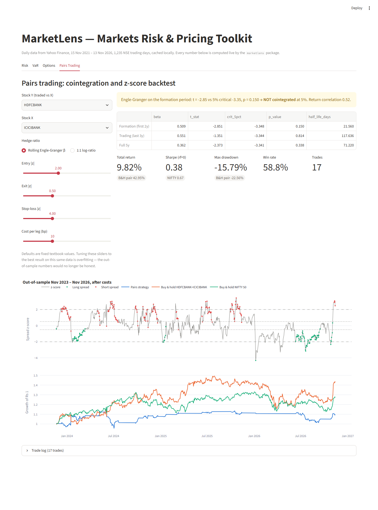

# MarketLens: Markets Risk & Pricing Toolkit

A Python, Excel and VBA toolkit covering the core quantitative work of a markets desk: **risk measurement (VaR/ES), derivatives pricing and hedging, and a statistical-arbitrage strategy**. It runs on five years of real Indian market data (NIFTY 50, five NSE large caps, USD/INR, gold) and a real US option chain.

Every number in this README was produced by the code in this repo, from the cached data in `data/`, and is reproducible offline. 77 automated tests check the maths.



---

## Contents
1. [Problem](#problem)
2. [Data](#data)
3. [Methods and formulas](#methods-and-formulas)
4. [Key results](#key-results)
5. [Excel and VBA](#excel-and-vba)
6. [Dashboard](#dashboard)
7. [How to run](#how-to-run)
8. [Project structure](#project-structure)
9. [Testing](#testing)
10. [Limitations](#limitations)

---

## Problem

A trading desk needs answers to three questions every day:

1. **How much could we lose?** Measure portfolio risk (Value-at-Risk, Expected Shortfall), and check whether the risk model would have been right in the past.
2. **What is this derivative worth, and how do we hedge it?** Price options, compute their sensitivities (Greeks), back out implied volatility from market prices, and test what delta hedging really costs.
3. **Is there a trade?** Test a relative-value idea (pairs trading) honestly, out-of-sample, after transaction costs.

MarketLens implements each of these from first principles, validates them against theory and against each other, and presents them in a Streamlit dashboard and an Excel workbook with VBA.

## Data

| Asset | Ticker | Notes |
|---|---|---|
| NIFTY 50 | `^NSEI` | Indian large-cap benchmark |
| RELIANCE, TCS, HDFCBANK, INFY, ICICIBANK | `*.NS` | Five large NSE stocks |
| USD/INR | `INR=X` | Rupees per dollar (a rise means the rupee is weakening) |
| Gold | `GC=F` | COMEX front-month future, USD |
| SPY option chain | `SPY` | One expiry (2026-12-18), quotes from 2026-11-13. Used for the implied-volatility smile, because Yahoo has no NIFTY chain |

- **Period:** 15 Nov 2021 to 13 Nov 2026. That is 1,235 NSE trading days and 1,234 daily log returns, with **0 NaNs**.
- **Source:** free Yahoo Finance data via `yfinance` (`auto_adjust=True`, so prices are adjusted for splits, bonuses and dividends). Cached to CSV, so everything runs offline.
- **Cleaning:**
  - All series are aligned to the NSE trading calendar.
  - Gaps of at most 3 days are forward-filled. This affected 40 gold prices and 4 USD/INR prices, mainly on US holidays.
  - Days with a move larger than ±15% are flagged for review, but kept. None were flagged.

## Methods and formulas

### 1. Risk analytics (`marketlens/risk.py`)

| Metric | Formula |
|---|---|
| Log return | rₜ = ln(Pₜ / Pₜ₋₁) |
| Annualised return (CAGR) | exp(252 · mean(r)) − 1 |
| Annualised volatility | σ_daily · √252 |
| Sharpe ratio | (252 · mean(r) − ln(1 + r_f)) / σ_annual, with r_f = 6% (an assumption, set in `config.py`) |
| Max drawdown | minₜ (Pₜ / max₍ₛ≤ₜ₎ Pₛ − 1) |
| Portfolio return | R_p = Σ wᵢ (e^{rᵢ} − 1). Simple returns, because log returns don't add across assets |

**Value-at-Risk and Expected Shortfall.** These are 1-day figures for an equal-weight portfolio of the five stocks, ₹1 crore in total, estimated on the last 250 days. Both are reported as positive numbers (losses).

| Method | VaR at confidence level α | Expected Shortfall |
|---|---|---|
| Historical | −quantile₁₋α(R_p) | −mean(R_p ∣ R_p ≤ quantile) |
| Parametric (variance-covariance) | z_α · σ_p − μ_p, where σ_p = √(wᵀΣw) | σ_p · φ(z_α)/(1 − α) − μ_p |
| Monte Carlo | Simulate μ + LZ with Σ = LLᵀ (Cholesky), 10,000 scenarios, then take the quantile | Mean of the simulated tail |

**Backtest.** For each of the last 250 days, VaR is estimated using only the 250 days before it, then compared with the loss that actually happened (no look-ahead). The breaches are tested with the **Kupiec proportion-of-failures test**:

LR = −2 ln[(1−p)^(T−x) pˣ] + 2 ln[(1−x/T)^(T−x) (x/T)ˣ] ~ χ²(1)

Here p = 1 − α is the expected breach rate, x the number of breaches and T the number of days. The 99% results are also given a Basel traffic-light zone (Green 0–4 breaches, Yellow 5–9, Red 10+).

### 2. Options (`marketlens/options.py`)

- **Black-Scholes(-Merton)**, with continuous dividend yield q:
  - d₁ = [ln(S/K) + (r − q + σ²/2)T] / (σ√T), and d₂ = d₁ − σ√T
  - Call = S e^{−qT} N(d₁) − K e^{−rT} N(d₂)
  - Put = K e^{−rT} N(−d₂) − S e^{−qT} N(−d₁)
- **Greeks:** delta, gamma, vega (per 1 vol point), theta (per calendar day) and rho (per 1%). Closed-form, and checked against numerical derivatives in the tests.
- **Monte Carlo under geometric Brownian motion:**
  - S_T = S · exp((r − q − σ²/2)T + σ√T · Z)
  - Price = e^{−rT} · mean(payoff), with standard error = sd/√N
  - Antithetic variates (pairing each Z with −Z) are used to reduce variance.
- **Implied volatility:**
  - Newton-Raphson: σ ← σ − (BS(σ) − price) / vega, started from the Manaster-Koehler point √(2|ln(F/K)|/T).
  - Bisection fallback when vega is close to zero.
  - Rejects inputs where no volatility can produce the price (outside no-arbitrage bounds, or no time value) instead of returning a meaningless σ.
- **Implied forward** from put-call parity: F = K + e^{rT}(C − P), averaged over the 6 strikes nearest the money.
- **Delta hedging:**
  - Sell a call, hold Δ shares, rebalance at each step, and finance at r.
  - P&L = cash + Δ·S_T − payoff.
  - Attribution: daily P&L ≈ ½ Γ S² (σ²_implied dt − (ΔS/S)²), which is the gamma-theta trade-off.

### 3. Pairs trading (`marketlens/strategy.py`)

- **Engle-Granger test:**
  - Regress ln Y on ln X by OLS; the residual is the spread.
  - Run an ADF unit-root test on the residuals, using MacKinnon critical values.
  - Half-life of mean reversion = −ln 2 / ln(1 + φ), from Δeₜ = φ·eₜ₋₁ + εₜ.
- **Signal:**
  - z = (spread − 60-day mean) / 60-day standard deviation, with a rolling 250-day hedge ratio β (or a fixed 1:1 log-ratio as a baseline).
  - Enter when |z| > 2, exit when |z| < 0.5, stop-loss when |z| > 4.
- **No look-ahead:**
  - Every estimate on day t uses data up to t only.
  - The trade is executed at the next day's close.
  - The cointegration test uses only the first 2 years. All performance figures come from the following 3 years.
  - A test shocks future prices and checks that no past position changes.
- **Costs:** 10 bp per leg on every change in weights. Capital = gross exposure.

## Key results

### Risk (5 years)

| Asset | Ann. return | Volatility | Sharpe | Max drawdown |
|---|---|---|---|---|
| NIFTY 50 | 6.93% | 13.96% | 0.06 | −16.47% |
| RELIANCE | 2.85% | 22.86% | −0.13 | −27.18% |
| TCS | −4.88% | 22.92% | −0.47 | −53.39% |
| HDFCBANK | 2.03% | 21.25% | −0.18 | −31.74% |
| INFY | −5.87% | 26.42% | −0.45 | −48.17% |
| ICICIBANK | 16.69% | 19.82% | 0.48 | −20.73% |
| USD/INR | 4.92% | 5.28% | −0.19 | −3.84% |
| Gold (USD) | 16.16% | 19.59% | 0.47 | −26.95% |

**Correlation:**
- **Within sectors:** TCS–INFY 0.73, HDFCBANK–ICICIBANK 0.52.
- **Gold vs stocks:** 0.01–0.11.
- **NIFTY vs USD/INR:** −0.13 over the full 5 years. The rolling 60-day value swung between −0.54 (March 2026) and +0.48 (August 2024).

### VaR: equal-weight 5 stocks, ₹1 crore, 1-day, last 250 days

| Method | 95% VaR | 95% ES | 99% VaR | 99% ES |
|---|---|---|---|---|
| Historical | 1.711% (₹1.71 L) | 2.290% | 2.471% (₹2.47 L) | 2.951% (₹2.95 L) |
| Parametric | 1.810% | 2.263% | 2.549% | 2.917% |
| Monte Carlo (10k) | 1.795% | 2.233% | 2.520% | 2.827% |

**Backtest over 2025-11-10 to 2026-11-13 (250 days, out-of-sample):**

| Method | 95% breaches (expected 12.5) | Kupiec p | 99% breaches (expected 2.5) | Kupiec p | Basel zone |
|---|---|---|---|---|---|
| Historical | 20 | **0.044 (rejected)** | 6 | 0.059 | Yellow |
| Parametric | 18 | 0.133 | 6 | 0.059 | Yellow |
| Monte Carlo | 18 | 0.133 | 6 | 0.059 | Yellow |

All three models had more breaches than expected over the last year, so they underestimated risk. The 99% models pass Kupiec, but only barely, and fall in the Basel Yellow zone. The main reason is that a 250-day window reacts slowly when volatility rises. EWMA or GARCH volatility (which weights recent days more) is the natural next step.



### Options

| Check | Result |
|---|---|
| Black-Scholes (S = K = 100, T = 1, r = 5%, σ = 20%) | Call **10.4506**, put **5.5735**. Delta 0.6368, gamma 0.0188, vega 0.3752, theta −0.0176/day, rho 0.5323 |
| Put-call parity | C − P = S − Ke^{−rT} = 4.877058 (exact to 6 decimals) |
| Monte Carlo convergence (20 seeds per path count) | Mean absolute error 11.7% at 100 paths, **0.25% at 100k**, 0.12% at 1M. Log-log slope −0.523 (theory −0.5) |
| Monte Carlo at 100k paths, seed 42 | 10.4205 vs 10.4506 (0.29%). Antithetic variates cut the standard error from 0.0468 to 0.0331 |
| Implied-vol round trip | σ recovered to within 1.3 × 10⁻¹¹. Prices with no time value are flagged, not solved |
| Real SPY chain | 161 liquid out-of-the-money options solved by Newton in ≤ 11 iterations. Average difference from Yahoo's IV: 0.32 vol points |
| SPY skew | At-the-money IV 15.4%; 37.3% at K/F = 0.80; minimum 11.6% at K/F = 1.06 |




**Delta hedging a 3-month at-the-money call (20,000 simulated paths, σ = 20%, premium 4.49):**

| Scenario | Mean P&L | Std dev of P&L |
|---|---|---|
| Daily hedge | −0.0001 | 0.44 (9.8% of premium) |
| Weekly hedge | 0.0047 | 0.94 |
| Monthly hedge | −0.0081 | 1.80 |
| Daily hedge + 5 bp costs | −0.18 | 0.45 |
| Daily hedge, realised vol 25% vs 20% sold | −0.97 (≈ the 0.96 Black-Scholes price gap) | 0.68 |

- **Rebalancing frequency:** the hedging error scales as 1/√(number of rebalances). Weekly vs daily gives 2.15×, against a theoretical √5 = 2.24×.
- **Drift doesn't matter:** the simulated stock drifts at 12% a year, not r, and the hedged P&L is still unbiased.

**Real NIFTY path (12 Aug – 13 Nov 2026).** A short 3-month at-the-money call (strike 24,436, premium 837.6 points) was hedged daily at the trailing 1-year realised vol of 13.22%.
- **Result:** the hedged book ended at **−96.0 points (−11.5% of premium)**, even though the volatility actually realised (13.52%) was almost the same.
- **Why:** the book collected theta up to +104.8 points, then lost −96.2 and −75.4 points on 5 and 6 November. On those days NIFTY rallied +2.4% and +2.0% through the strike, close to expiry, where gamma is highest.
- **Attribution:** the gamma-theta formula explains −86.1 of the −96.0 points.
- **Lesson:** *when* volatility arrives matters, not just how much.



### Pairs trading: HDFCBANK / ICICIBANK

**Cointegration (Engle-Granger):**

| Period | t-stat | 5% critical | p-value | Half-life |
|---|---|---|---|---|
| Formation (first 2 years) | −2.85 | −3.35 | 0.150 | 22 days |
| Trading (last 3 years) | −1.35 | −3.34 | 0.814 | 118 days |
| Full 5 years | −2.37 | −3.34 | 0.338 | 71 days |

The pair is **correlated (0.52) but not cointegrated** at 5% in any period. No pair of the five stocks is robustly cointegrated: the two that scrape p < 0.05 in the formation period both fail afterwards. With 10 pairs tested, about 0.5 false positives are expected by chance.

**Out-of-sample performance (21 Nov 2023 – 13 Nov 2026, after 10 bp costs, 1-day execution lag):**

| Strategy | Total return | CAGR | Volatility | Sharpe (r_f = 0) | Max drawdown | Trades | Win rate |
|---|---|---|---|---|---|---|---|
| Pairs, rolling Engle-Granger β | 9.82% | 3.26% | 9.65% | **0.38** | −15.79% | 17 | 58.8% |
| Pairs, 1:1 log-ratio | 10.10% | 3.35% | 5.32% | 0.65 | −4.55% | 12 | 75.0% |
| Buy & hold 50/50 HDFCBANK + ICICIBANK | 42.95% | 13.03% | 17.62% | 0.78 | −22.56% | – | – |
| Buy & hold NIFTY 50 | 27.10% | 8.57% | 13.57% | 0.67 | −15.77% | – | – |

- **Cost sensitivity (rolling β):** Sharpe 0.51 at 0 bp, 0.38 at 10 bp, 0.25 at 20 bp.
- **Same rules on TCS / INFY:** Sharpe 0.32 (rolling β) and 0.87 (1:1).
- **Verdict:** the backtest confirms the cointegration test. Without a stable long-run relationship, the strategy earns thin, unstable returns. It was in the market only 38% of the time and gave up the banks' rally. The daily rolling hedge ratio swung from −0.49 to 1.86, which hurt more than it helped.



## Excel and VBA

`python -m marketlens.excel_export` writes **`reports/MarketLens.xlsx`**, an 8-sheet workbook:

| Sheet | Contents |
|---|---|
| Summary | Headline numbers from every section |
| Risk | Asset metrics and correlation matrix, with conditional formatting |
| VaR | VaR/ES table, a native Excel chart, and the Kupiec backtest |
| VaR Macro | Inputs for the VBA macro, plus the Python reference values to check it against |
| Greeks | Black-Scholes prices and Greeks across strikes |
| Pricer | A live calculator: native Excel formulas and the VBA functions side by side |
| Pairs | Strategy performance and trade log |
| Returns | Raw daily returns used by the macro |

**`vba/MarketLens.bas`** adds:
- **Worksheet functions:** `=BS_PRICE()`, `=BS_GREEK()` and `=BS_IMPLIED_VOL()`.
- **`RefreshVaR` macro:** reads editable weights, window and confidence levels, recomputes historical and parametric VaR/ES, and rebuilds two charts.

**Verified against Python:**
- The Pricer's native formulas match the Python values to 6 decimals.
- The macro's VaR matches Python to under 10⁻⁵ basis points.

Step-by-step `.xlsm` setup: [`vba/README_VBA.md`](vba/README_VBA.md).

## Dashboard

`streamlit run app.py` opens four tabs: **Risk, VaR, Options, Pairs Trading**. Every input is editable: portfolio weights, VaR window, option parameters, hedging frequency, realised vs implied vol, pair selection and z-score thresholds. The app contains no maths of its own; it calls the same tested functions as the report scripts.

| Risk | Options | Pairs |
|---|---|---|
|  |  |  |

## How to run

```bash
git clone https://github.com/harshith7002/MarketLens.git
cd MarketLens
python -m venv .venv
.venv\Scripts\activate            # Windows  (macOS/Linux: source .venv/bin/activate)
pip install -r requirements.txt
```

| Command | What it does |
|---|---|
| `python -m marketlens.data` | Re-download prices (optional; the cached CSVs already ship with the repo) |
| `python scripts/run_risk.py` | Phase 2 tables and charts → `reports/` |
| `python scripts/run_options.py` | Phase 3 tables and charts |
| `python scripts/run_strategy.py` | Phase 4 tables and charts |
| `python -m marketlens.excel_export` | Builds `reports/MarketLens.xlsx` |
| `streamlit run app.py` | Starts the dashboard at http://localhost:8501 |
| `pytest -q` | Runs all 77 tests (~20 s) |
| `python scripts/take_screenshots.py` | Regenerates the README screenshots (needs `pip install playwright` and Edge or Chrome) |

Requires Python 3.11+. Uses no paid APIs.

## Project structure

```
MarketLens/
├── app.py                    # Streamlit dashboard (4 tabs)
├── marketlens/
│   ├── config.py             # every setting and assumption in one place
│   ├── data.py               # download, clean, log returns, CSV cache, SPY chain
│   ├── risk.py               # metrics, correlation, VaR/ES (3 methods), backtest, Kupiec
│   ├── options.py            # Black-Scholes, Greeks, Monte Carlo, implied vol, delta hedging
│   ├── strategy.py           # Engle-Granger, z-score signals, backtest, trade log
│   ├── excel_export.py       # formatted Excel workbook
│   └── plots.py              # matplotlib charts for reports/
├── vba/MarketLens.bas        # VBA functions + RefreshVaR macro (+ README_VBA.md)
├── scripts/                  # run_risk.py, run_options.py, run_strategy.py, take_screenshots.py
├── tests/                    # 77 pytest tests
├── data/                     # cached prices, returns, SPY option chain
├── reports/                  # result CSVs, MarketLens.xlsx, figures/
└── docs/screenshots/         # dashboard screenshots
```

## Testing

`pytest -q` runs 77 tests. They include the following:

| Test | What it checks |
|---|---|
| Put-call parity | Holds to 10⁻¹⁰ for 30 strike/maturity/dividend combinations |
| Monte Carlo accuracy | Price within **1%** of Black-Scholes at **100k paths**, and within 3 standard errors |
| VaR ordering | **95% VaR < 99% VaR**, and ES ≥ VaR, for every method |
| Data quality | **No NaNs** (or infinite values) in the returns |
| Greeks | Match numerical (finite-difference) derivatives |
| Implied vol | Round trip; bisection fallback; rejects arbitrage and zero-time-value prices |
| Kupiec | Perfect calibration gives p = 1; far too many breaches are rejected; 0 breaches is handled |
| No look-ahead | Shocking future prices leaves past VaR forecasts and pairs positions unchanged |
| Hedging | P&L is unbiased for any drift; error scales as √(rebalancing frequency) |
| Cointegration | Detects a synthetic cointegrated pair; rejects independent random walks |
| Pairs bookkeeping | The trade log reconciles exactly with the equity curve |
| Excel / VBA | Every cell the VBA reads is where the `.bas` expects it |
| Dashboard | All four tabs render headlessly, and the numbers match the library |

## Limitations

- **Data**
  - Free Yahoo Finance data. USD/INR closes at a different time from the NSE, so their daily returns are slightly out of sync.
  - Forward-filled gold prices understate its volatility a little.
  - Gold is kept in USD, not converted to INR.
- **Assumptions:** r_f = 6% (INR) and 4% (USD) are flat assumptions, not market curves.
- **VaR:**
  - Equal-weighted window with no volatility scaling (EWMA or GARCH would react faster).
  - Parametric and Monte Carlo VaR assume normal returns.
  - 1-day horizon only.
  - Kupiec tests only the *number* of breaches, not whether they cluster together (Christoffersen's test would check that).
- **Options:**
  - Black-Scholes assumes constant volatility, but the SPY skew shows it isn't.
  - SPY options are American; the early-exercise premium is visible in the put-call parity slope (−1.0138 vs −0.9962).
  - The SPY chain is a single snapshot.
  - The hedging simulation ignores discrete dividends and margin.
- **Pairs trading:**
  - Retail investors can't hold an overnight short in Indian cash equities, so a real implementation would short single-stock futures (lot sizes, rollover costs).
  - Trades are assumed at closing prices with a flat cost.
  - 17 trades is a small sample.
  - The HDFC–HDFC Bank merger (July 2023) is a structural break.
- **Backtest honesty:** the strategy settings are textbook defaults that were never tuned. Optimising them on this same data would inflate the results.
